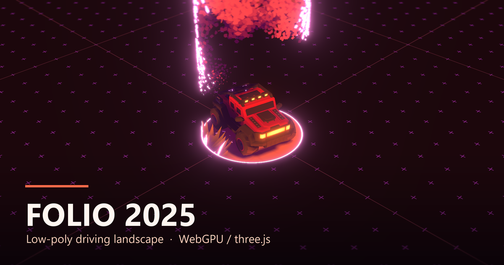

# Folio 2025 · 汽车驾驶场景

Bruno Simon 的 [folio-2025](https://github.com/brunosimon/folio-2025) 里的汽车场景：
开一辆低模车在程序化地形里跑，草、落叶、雨雪、昼夜与风全部实时。

**在线试玩：<https://shui-ke.github.io/shuike-folio/>**

| 操作 | 作用 |
| --- | --- |
| `W A S D` | 驾驶 |
| `Shift` | 加速 |
| `Space` | 跳跃 |
| 鼠标 | 视角 |
| `R` | 重生 |
| `Esc` | 设置 |

## 目录

| 路径 | 说明 |
| --- | --- |
| `game/` | 预构建的静态站点，GitHub Pages 直接发布这个目录（相对路径，可放在任意子路径下） |
| `bruno-original/` | 完整源码（MIT），`npm install --force` 后 `npm run build` 可重新构建 |
| `.github/workflows/pages.yml` | 推送到 `main` 自动部署到 Pages |

`game/` 与 `bruno-original/dist/` 内容一致，只去掉了 `sounds/musics/` 里三首曲子的 `.wav` 源文件
（约 130MB），保留实际加载的 `.mp3`，所以试玩音频不受影响。

## 截图与图标

| 文件 | 尺寸 | 用途 |
| --- | --- | --- |
| [`shots/cover-1200x630.png`](shots/cover-1200x630.png) | 1200 × 630 | 项目封面 / Open Graph（带标题版） |
| [`shots/cover-plain-1200x630.png`](shots/cover-plain-1200x630.png) | 1200 × 630 | 同上，纯截图无文字 |
| [`shots/desktop-1440x900.png`](shots/desktop-1440x900.png) | 1440 × 900 | 桌面截图（首页） |
| [`shots/mobile-390x844.png`](shots/mobile-390x844.png) | 390 × 844 | 手机截图（游戏中） |
| [`shots/icon-180.png`](shots/icon-180.png) | 180 × 180 | App 图标 |
| [`shots/favicon-32.png`](shots/favicon-32.png) | 32 × 32 | 网站图标 |
| [`shots/icon-1024.png`](shots/icon-1024.png) | 1024 × 1024 | 图标源文件 |

站点的 favicon 与 `og:image` 已经接到 `game/` 里（`favicon-32.png`、`favicon-180.png`、`apple-touch-icon-180.png`、`og-cover.png`）。

## 来源与许可

- 代码：MIT，© 2025 Bruno Simon，全文见 [`bruno-original/license.md`](bruno-original/license.md)
- 音乐：CC0（见 `bruno-original/static/sounds/musics/license.md`）
- 本仓库是对上述开源项目的公开镜像与部署，托管、裁剪与构建脚本调整 by Shuike

原始项目：<https://github.com/brunosimon/folio-2025>
