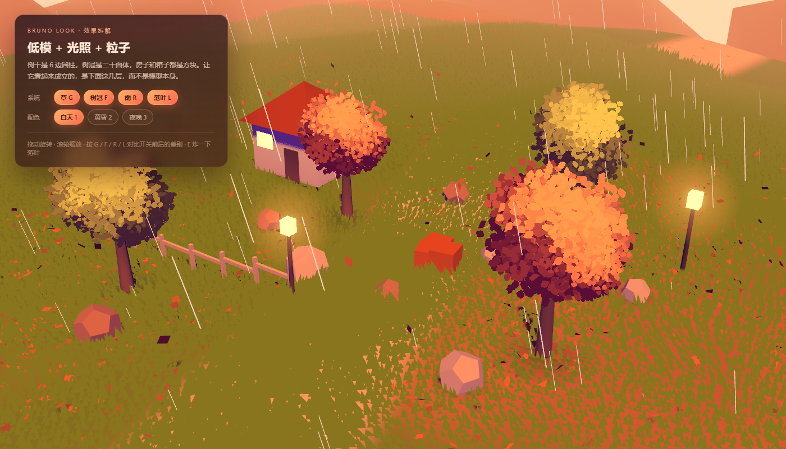
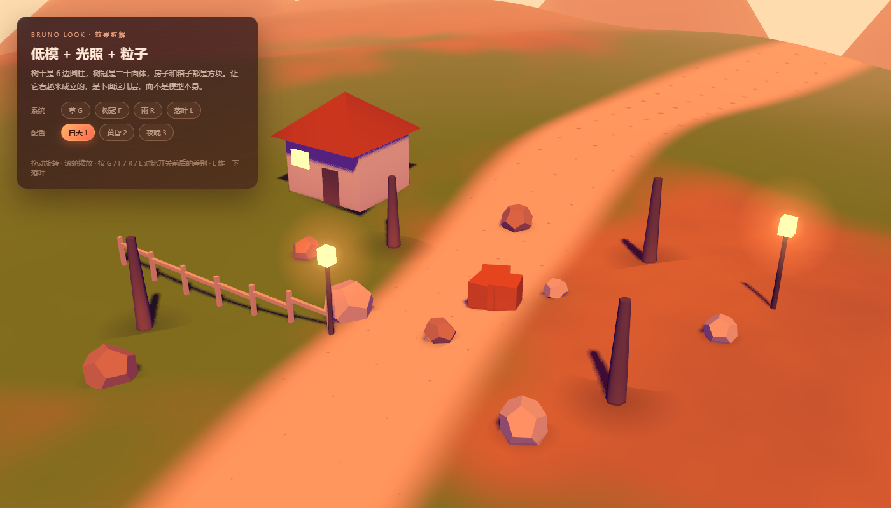
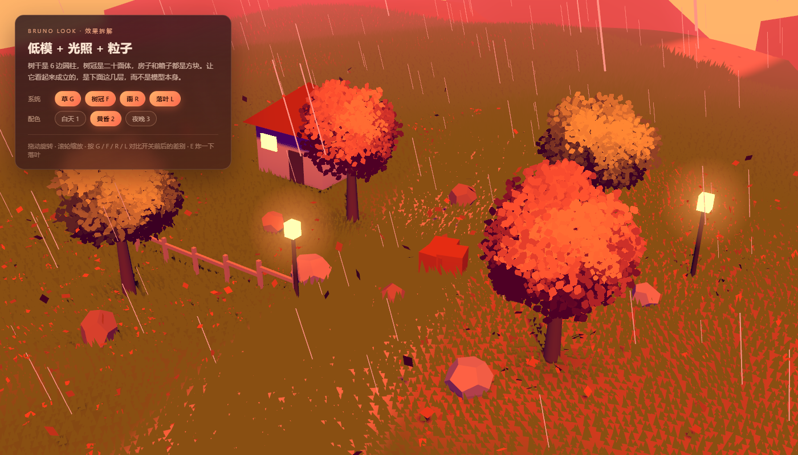

# Shuike Look

**低模 + 特效的 WebGPU 实验。** 树干是 6 边圆柱，树冠是二十面体，房子 / 箱子 / 石头全是方块，
没有贴图、没有法线贴图、没有 LOD —— 画面全部由着色器撑起来。

> 灵感来源与对照实现：[Bruno Simon · folio-2025](https://github.com/brunosimon/folio-2025)（MIT）。
> 原版源码完整保留在 `../bruno-original/`，下面每个系统都能在那里找到对应文件。

| 系统 | 文件 | 说明 |
| --- | --- | --- |
| 三色打光 | `src/Look.js` | 受光色 × 1.35、背光换成紫影、地面反弹、距离雾；shadow map 只取一个值 |
| 草 | `src/Grass.js` | 129,600 根 × 3 顶点，1 个 Mesh、1 次 draw call；顶点着色器做 billboard + 风 + 循环 |
| 树冠 | `src/Foliage.js` | 每棵树冠 80 张 alpha 卡片 + 128×128 SDF，整团朝向相机；see-through / maskShadowNode / shadowOffset 都在 |
| 雨 | `src/RainLines.js` | 1400 条线，全在 0..1 盒子里循环；雨量 = 一个 uniform |
| 落叶 | `src/Leaves.js` | position / velocity 两个 buffer + init/update 两次 compute（车推、风、爆炸、升力、阻尼、重力、贴地、循环）；没有 compute 时在 CPU 上跑同一组方程 |
| 地形 | `src/Terrain.js` | 正弦高度场 + 噪声遮罩（草 / 土 / 石板），CPU 与 GPU 共用公式 |
| 烂模型 | `src/Models.js` | 圆柱、二十面体、方块、接触阴影、灯笼光晕 |

## 运行

无需安装依赖，仓库里已经带好 three.js 和静态服务器：

```bash
node serve.mjs . 4181
```

然后打开 <http://127.0.0.1:4181/>。Windows 也可以直接双击 `Play.cmd`。

## 操作

| 输入 | 作用 |
| --- | --- |
| 拖动 / 滚轮 | 旋转 / 缩放 |
| `G` | 草 |
| `F` | 树冠卡片 |
| `R` | 雨 |
| `L` | 落叶 |
| `E` | 在风源处“炸”一下落叶 |
| `1` `2` `3` | 白天 / 黄昏 / 夜晚 |

把 `G`、`F`、`R`、`L` 全部关掉，就能看到“原始模型”有多寒酸 —— 这也是这个示例想说明的事。

## 截图

| 完整效果 | 关掉草 / 树冠 / 雨 / 落叶 | 黄昏 |
| --- | --- | --- |
|  |  |  |

## 许可

MIT，见 `../LICENSE`。本项目基于 Bruno Simon 的 folio-2025（MIT）重写，
原始代码版权归 Bruno Simon 所有，其许可全文见 `../bruno-original/license.md`。
